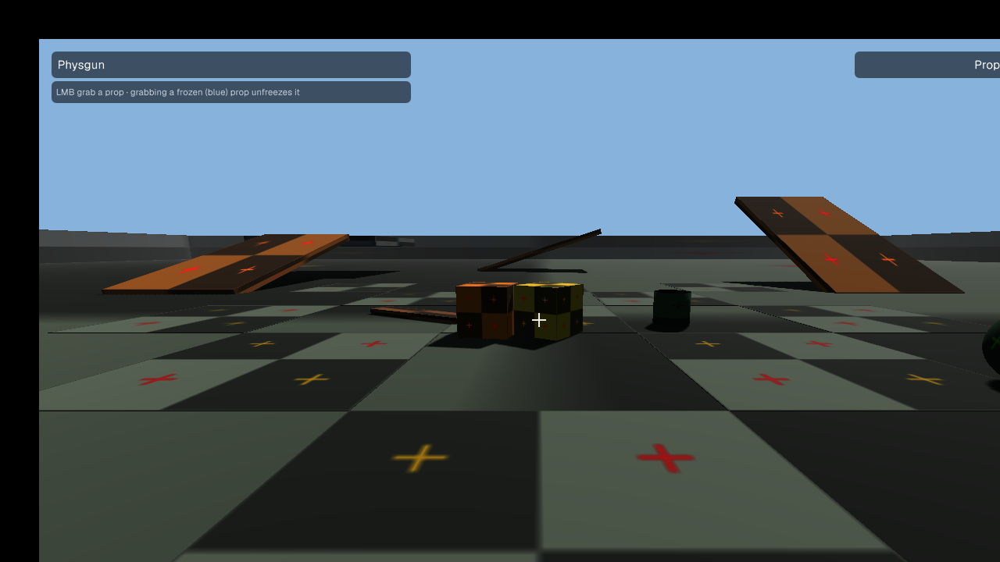
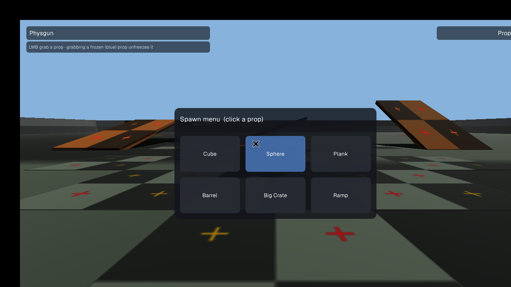

# Sandbox

A small Garry's Mod-style physics sandbox in C# on the [Prowl](https://github.com/ProwlEngine/Prowl) runtime (v1.0-preview, MIT). Physics is Jitter Physics 2, which ships inside Prowl. UI uses Prowl's immediate-mode UI (Paper).

`Prowl.Runtime` is not on NuGet, so this repo vendors it as a git submodule at `external/Prowl`, pinned to the `v1.0-preview` tag (`50d287009738cd3ea7b6350221ae58f639a4aa39`).




## Run on Windows

1. Install the [.NET 10 SDK](https://dotnet.microsoft.com/download/dotnet/10.0).
2. Clone the repo **with its submodule**:

   ```bat
   git clone --recurse-submodules https://github.com/Jax-Danger/sandbox-game.git
   cd sandbox-game
   ```

   Already cloned without it? Run `git submodule update --init --recursive`.

3. From the repo root:

   ```bat
   dotnet run
   ```

The first build downloads Prowl's NuGet dependencies, so it needs internet and takes a minute or two.

## What you see

A 1280×720 window titled **Sandbox**. You stand on a large 120 × 120 m floor with walls around the edge, three ramps, a raised platform, a free-standing wall and a staircase. A few starter props (cubes, a sphere, a barrel, a plank) sit in front of you. The props use Prowl's default grid texture.

The HUD shows a crosshair, the current tool and mode (top left), the prop count (top right), a control hint line (bottom) and short messages such as "Welded …" or "Undone …".

## Controls

| Input | Action |
| --- | --- |
| Mouse | Look (the cursor is locked while playing) |
| W A S D | Walk |
| Shift | Run (in noclip: fly faster) |
| Space | Jump (in noclip: fly up) |
| Ctrl | Fly down (noclip only) |
| V | Toggle noclip (fly through everything) |
| Hold Q or Tab | Spawn menu: click Cube, Sphere, Plank, Barrel, Big Crate or Ramp to spawn it where the crosshair points |
| 1 | Physgun |
| 2 | Toolgun: Weld |
| 3 | Toolgun: Remover |
| 4 | Toolgun: Balloon |
| Z | Undo the last spawn, weld or balloon |
| Esc | Pause menu: Resume, Clear map, Quit |

**Physgun (1):** hold left mouse on a prop to pick it up. The mouse wheel pushes it away or pulls it in. Let go to drop or throw it (it keeps its velocity). Right-click while holding to **freeze** it in place (it turns blue). Grabbing a frozen prop unfreezes it.

**Toolgun (2–4):** left click applies the mode:
- **Weld:** click one prop, then a second, and they're locked together.
- **Remover:** click a prop to delete it.
- **Balloon:** click a prop to tie a red balloon to it. Each balloon pulls up with about 1.4× the prop's weight, so it floats away. Freeze it or weld it to something heavy.

## Headless self-test

```bat
dotnet run -- --headless
```

This runs the game for about 6 seconds without a window. It scripts spawning, falling, physgun grab/hold/freeze/unfreeze/release, weld, balloon lift, undo, remover, spawn at the crosshair, clear map, and the player standing on the floor, prints PASS or FAIL for each, and exits 0 when everything passes. It doesn't test rendering or real mouse/keyboard input.

## Code layout

| File | Purpose |
| --- | --- |
| `src/Program.cs` | Entry point (`--headless` runs the self-test) |
| `src/SandboxGame.cs` | Game loop, input routing, tool selection, menus |
| `src/MapBuilder.cs` | Static test map and light |
| `src/Player.cs` | First-person CharacterController with gravity, jumping and noclip |
| `src/Props.cs` | Prop definitions, spawning, removal, undo stack |
| `src/PhysGun.cs` | Grab, hold, push/pull, throw, freeze |
| `src/ToolGun.cs` | Weld, remover and balloon (`Balloon` component) |
| `src/SpawnMenu.cs`, `src/PauseMenu.cs`, `src/Hud.cs`, `src/Ui.cs` | Paper UI |
| `src/SelfTest.cs` | Headless scripted checks |

## Requirements that can stop the window opening

- A GPU and driver with OpenGL 4.1 (Prowl requests a 4.1 core context).
- The native libraries under `external/Prowl/Libraries`, which are copied next to the build automatically. Don't delete the submodule.
