# Sandbox

A Garry's Mod-style physics sandbox with a DarkRP-style Roleplay mode, built in C# on the [Prowl](https://github.com/ProwlEngine/Prowl) engine (Jitter Physics 2, Paper UI).

## Features

- **Physgun**, **tool gun**, **spawn gun**, and **hands** pickup
- **Ragdolls** and wandering **NPCs** (citizens, police, hostiles)
- **Vehicles**: buggy, jeep, airboat
- **Weapons** with animated first-person view models (aim, reload, inspect)
- **Sandbox** and **Roleplay** modes — jobs, money, F4 city menu, buyable/lockable doors, laws board
- **Sessions** with thumbnails, autosave, and modifiers
- **Custom map** import (glTF/FBX/OBJ) and remappable **keybinds**

## Screenshots (v1.0)

| | |
|---|---|
| 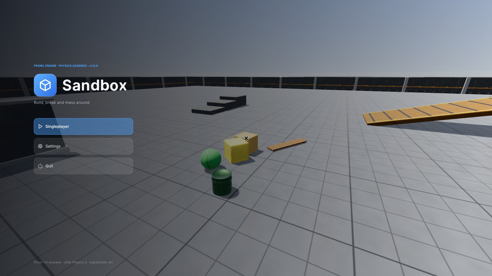 | 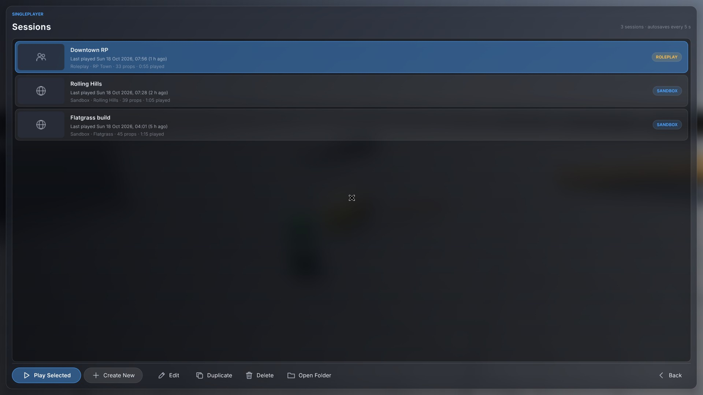 |
| 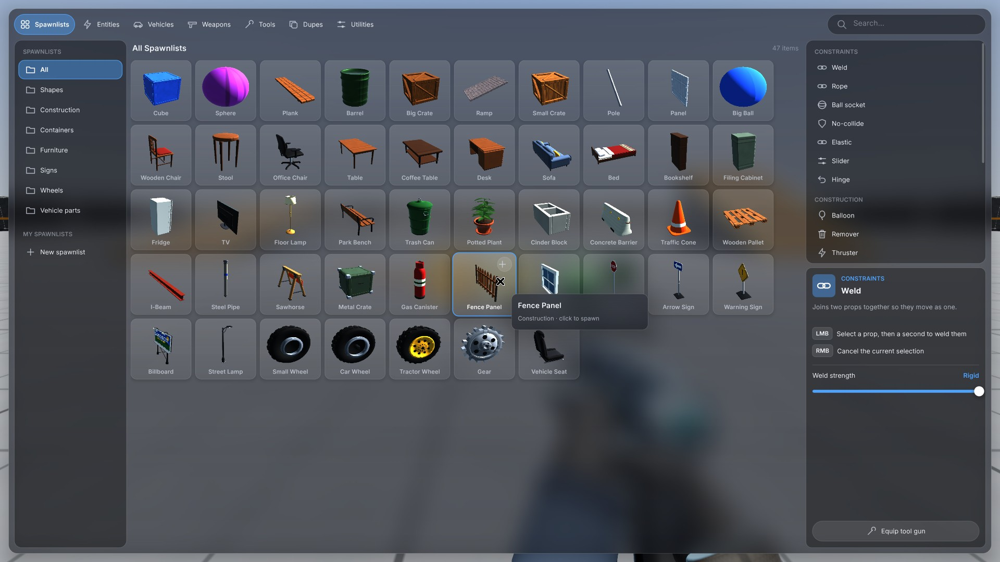 | 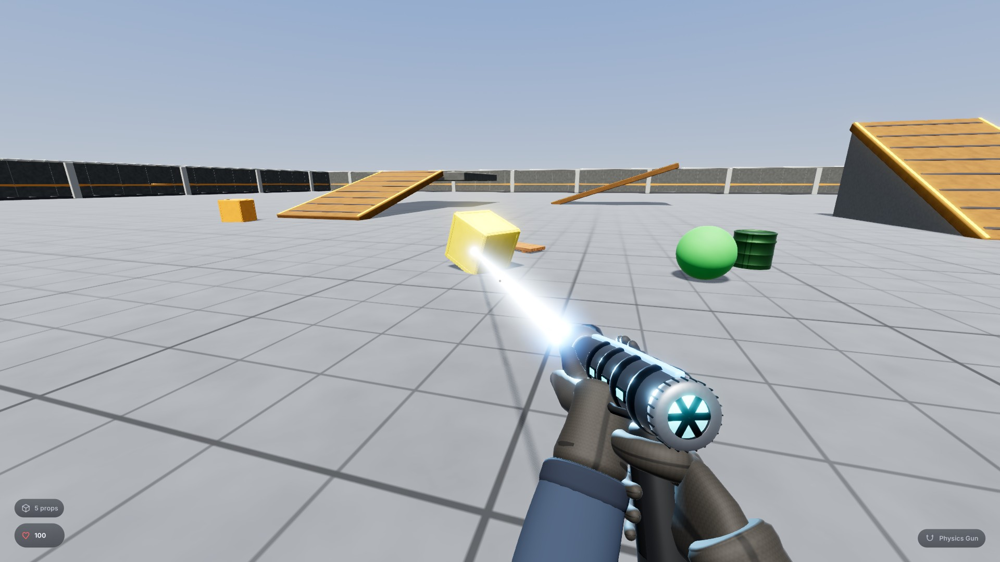 |
| 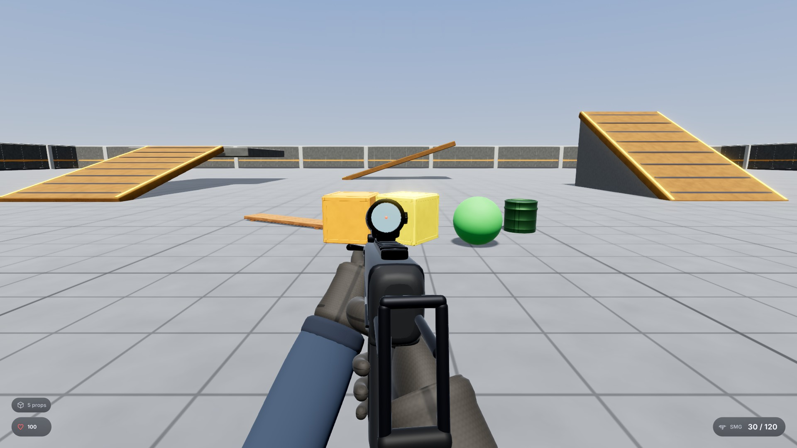 | 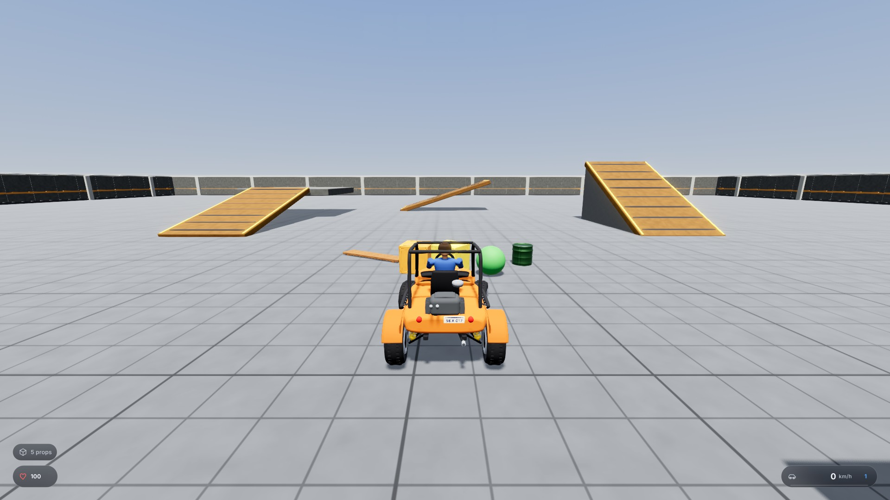 |
| 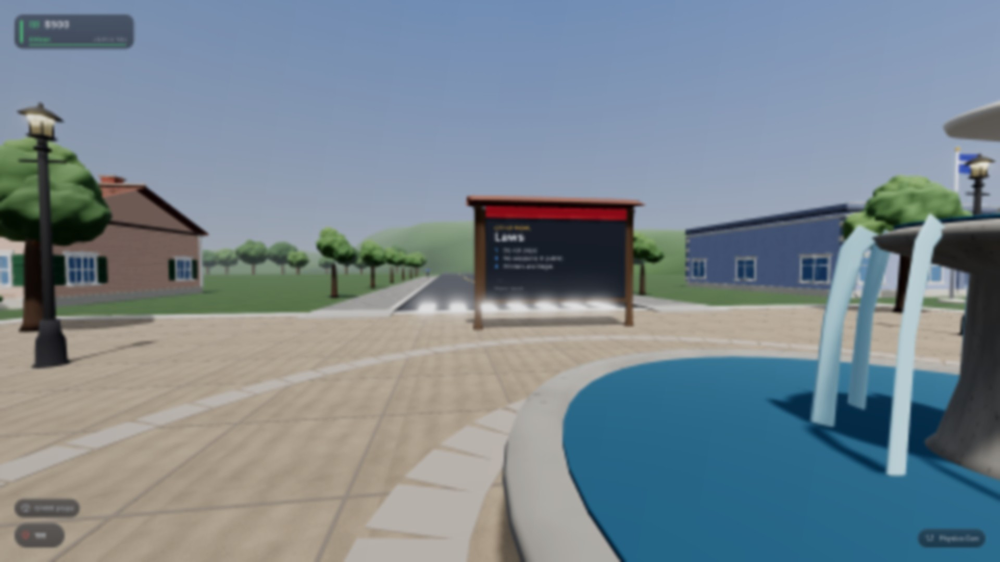 | 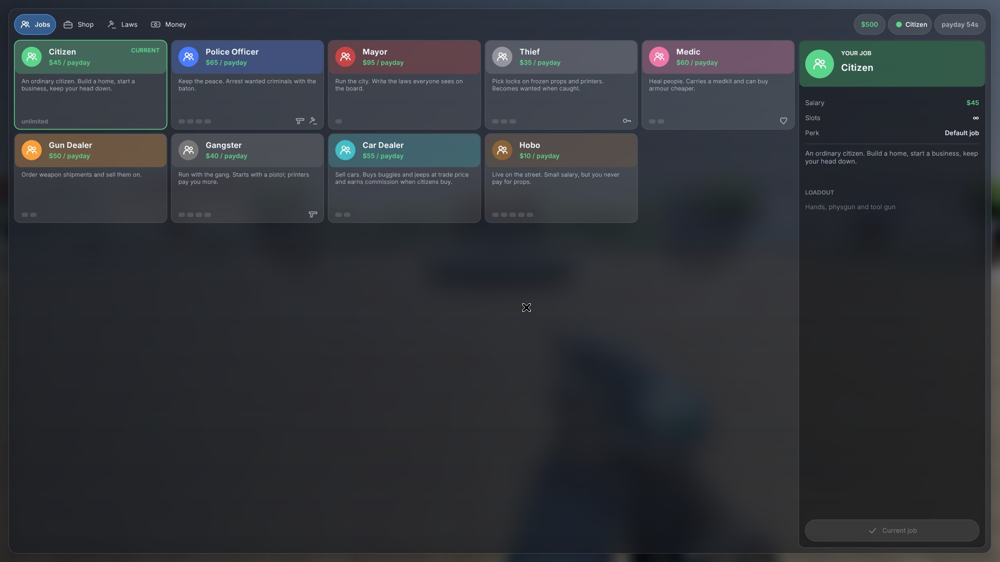 |
| 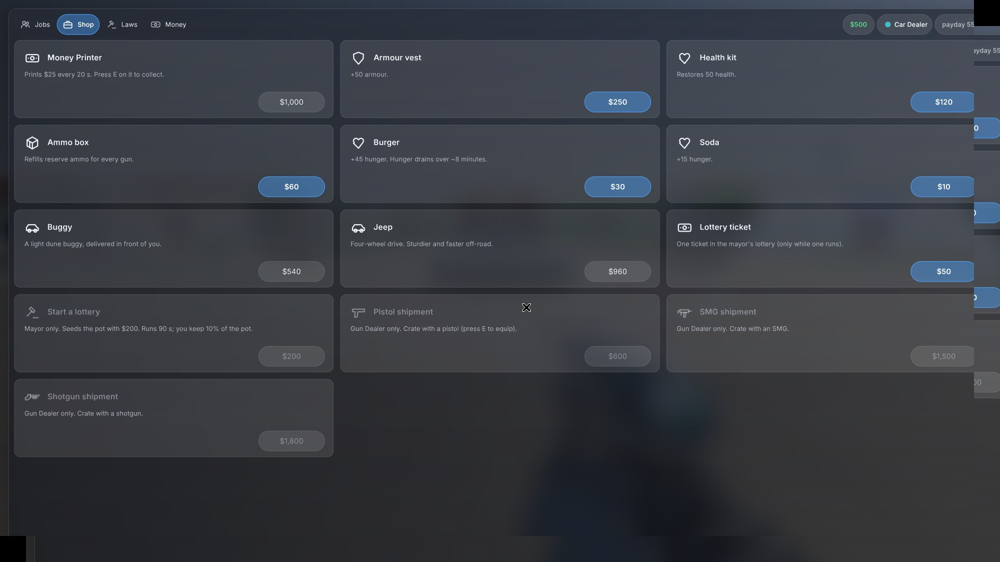 | 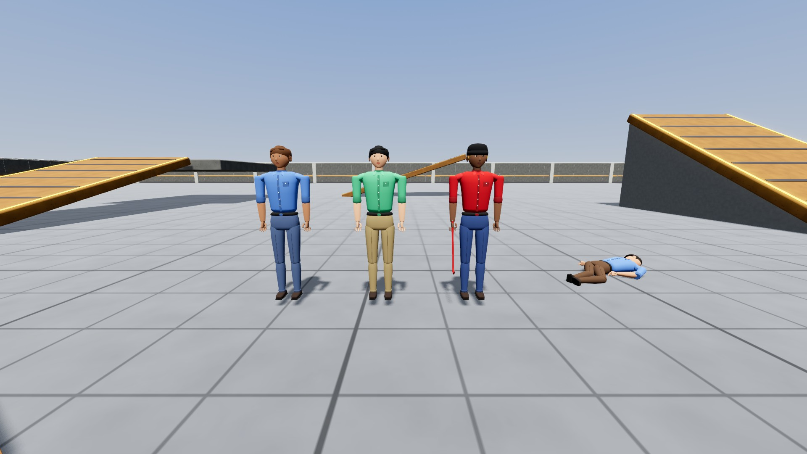 |
| 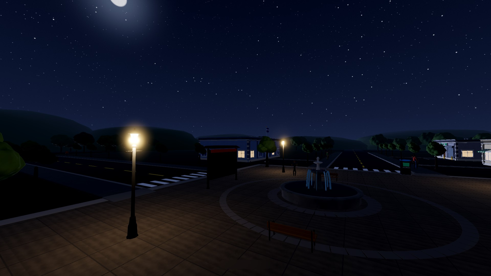 | 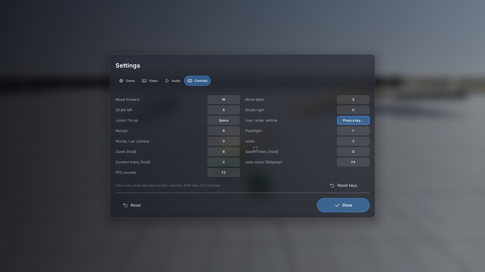 |

## Installation

Download the zip for your platform from [Releases](https://github.com/Jax-Danger/sandbox-game/releases). Builds are self-contained (no .NET install needed).

| Platform | Run |
|---|---|
| **Windows** | Unzip and run `Sandbox.exe`. If SmartScreen warns, choose *More info → Run anyway*. |
| **Linux** | `chmod +x Sandbox && ./Sandbox` (needs OpenGL 4.1+). |
| **macOS** | Open `Sandbox.app`. The app is unsigned: right-click → **Open**, or `xattr -dr com.apple.quarantine Sandbox.app`. |

Building from source, asset mods, view models, and the headless self-test are in **[docs/DEVELOPMENT.md](docs/DEVELOPMENT.md)**. Custom map empties: **[docs/MAPS.md](docs/MAPS.md)**.
