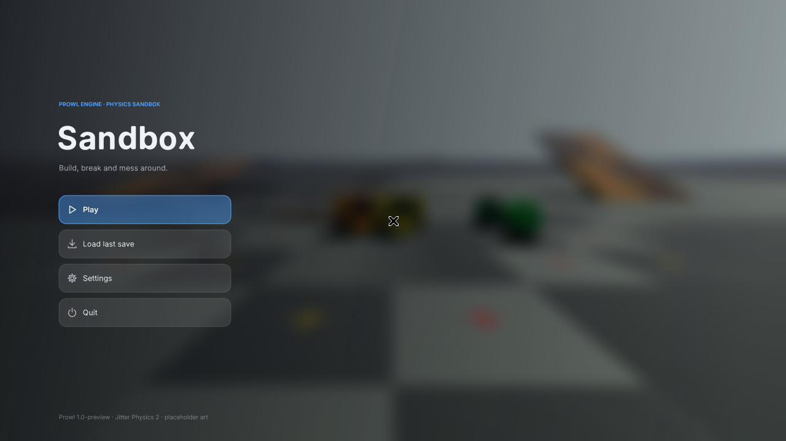
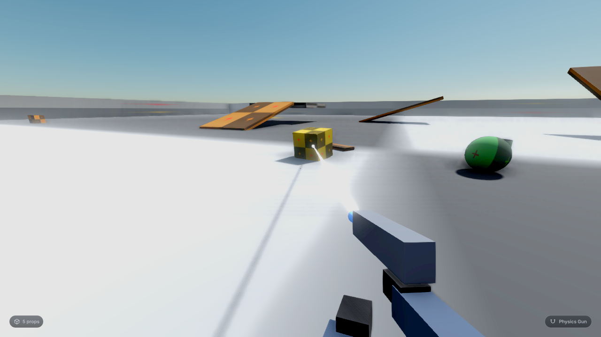
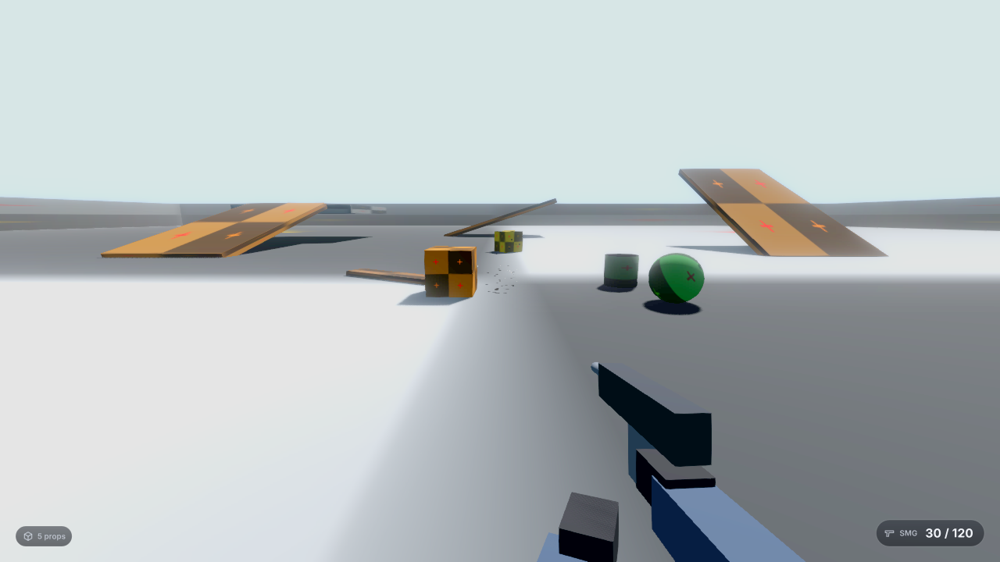
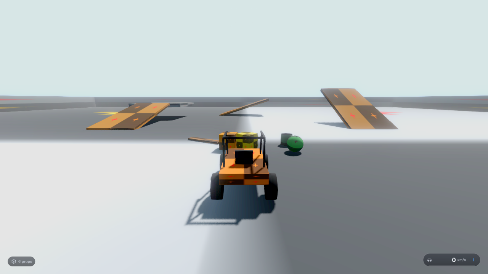
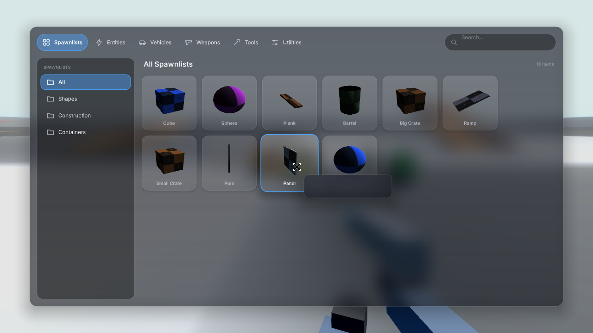
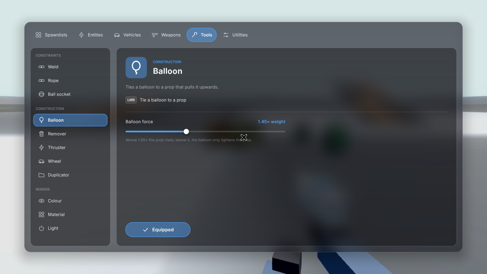
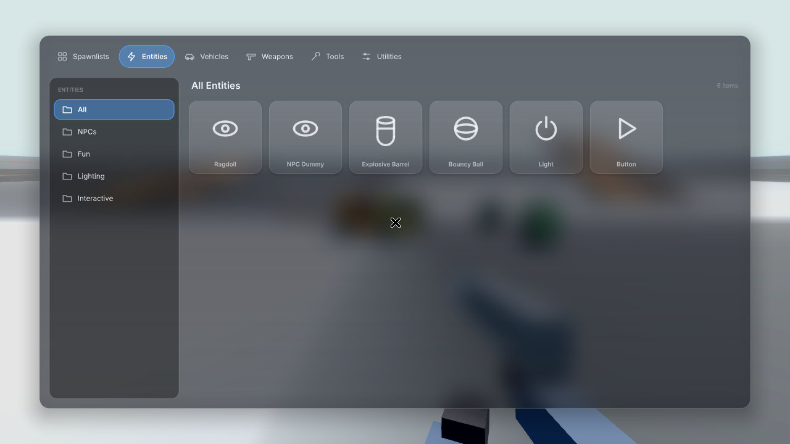
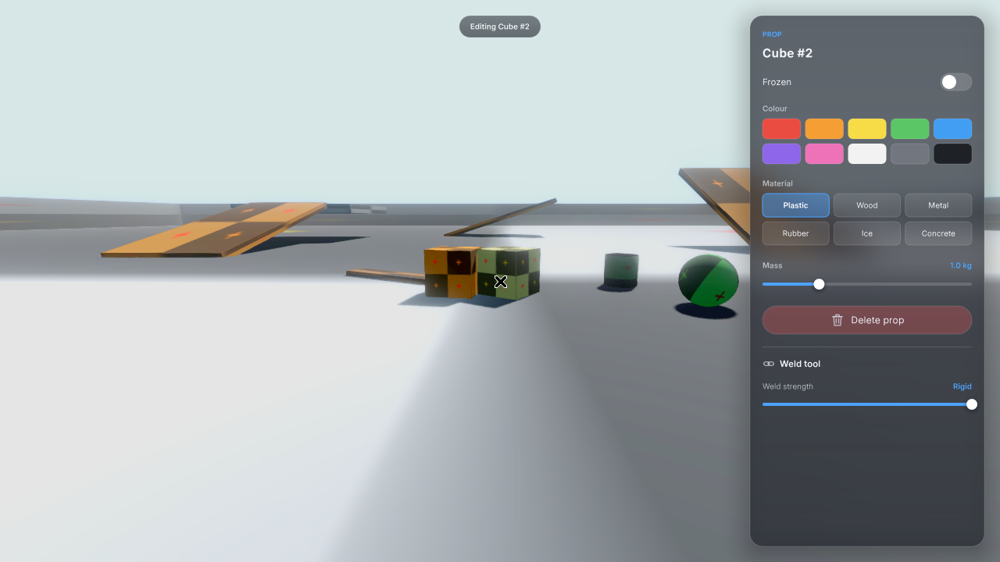
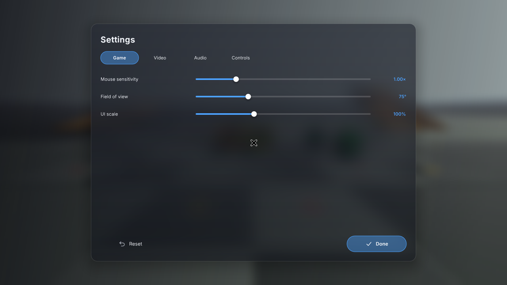
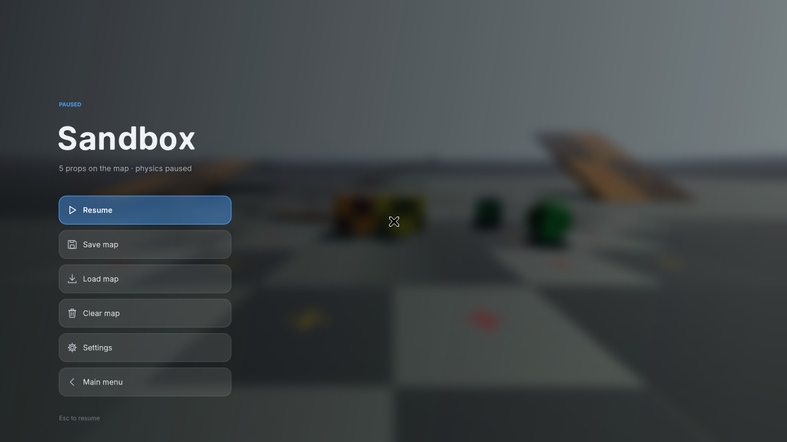

# Sandbox

A small Garry's Mod-style physics sandbox in C# on the [Prowl](https://github.com/ProwlEngine/Prowl) runtime (v1.0-preview, MIT). Physics is Jitter Physics 2, which ships inside Prowl. UI uses Prowl's immediate-mode UI (Paper).

`Prowl.Runtime` is not on NuGet, so this repo vendors it as a git submodule at `external/Prowl`, pinned to the `v1.0-preview` tag (`50d287009738cd3ea7b6350221ae58f639a4aa39`).

| | |
|---|---|
|  |  |
|  |  |
|  |  |
|  |  |
|  |  |

## Camera

Spawn **Entities → Utility → Camera** and aim it with the physgun. The newest camera streams to a picture-in-picture monitor in the top right, rendered to a RenderTexture every other frame. Cameras are saved with the map.

## Download & run

Grab the zip for your platform from [Releases](https://github.com/Jax-Danger/sandbox-game/releases). The builds are self-contained, so no .NET install is needed.

| Platform | Zip | Run |
|---|---|---|
| Windows 10/11 | `Sandbox-<ver>-win-x64.zip` | Unzip and run `Sandbox-win-x64\Sandbox.exe`. If SmartScreen warns, choose *More info → Run anyway*. |
| Linux x64 | `Sandbox-<ver>-linux-x64.zip` | `unzip …; chmod +x Sandbox-linux-x64/Sandbox; ./Sandbox-linux-x64/Sandbox`. Needs OpenGL 4.1+ drivers. |
| macOS Apple Silicon | `Sandbox-<ver>-osx-arm64.zip` | Unzip and open `Sandbox.app`. |
| macOS Intel | `Sandbox-<ver>-osx-x64.zip` | Unzip and open `Sandbox.app`. |

The macOS app is unsigned, so Gatekeeper blocks the first launch. Right-click → **Open**, or run `xattr -dr com.apple.quarantine Sandbox.app`. Prowl requests an OpenGL **4.1 core** forward-compatible context, which is the highest version macOS supports, so it works there.

### Building releases yourself

```bash
./build-all.sh 0.1.0                # all four: win-x64, linux-x64, osx-x64, osx-arm64 → dist/
./build-all.sh 0.1.0 linux-x64      # just one
```
```powershell
./build-all.ps1 -Version 0.1.0
```
Build macOS on a Mac when you can, because `build-all.sh` ad-hoc codesigns the `.app`, which Apple Silicon requires. CI (`packaging/ci/build.yml`; copy it to `.github/workflows/` to enable it) builds all four on every push, runs the headless self-test and an xvfb smoke run on Linux, and uploads them as artifacts. Pushing a `v*` tag publishes a GitHub Release with the zips.

## Run on Windows

1. Install the [.NET 10 SDK](https://dotnet.microsoft.com/download/dotnet/10.0).
2. Clone the repo **with its submodule**:

   ```bat
   git clone --recurse-submodules https://github.com/Jax-Danger/sandbox-game.git
   cd sandbox-game
   ```

   Already cloned without it? Run `git submodule update --init --recursive`.

3. From the repo root:

   ```bat
   dotnet run
   ```

The first build downloads Prowl's NuGet dependencies, so it needs internet and takes a minute or two.

## What you see

A 1280×720 window titled **Sandbox**. You stand on a large 120 × 120 m floor with walls around the edge, three ramps, a raised platform, a free-standing wall and a staircase. A few starter props (cubes, a sphere, a barrel, a plank) sit in front of you. The props use Prowl's default grid texture.

The HUD is deliberately minimal (s&box-style): a small dot crosshair that gets a ring when you aim at a prop, a prop-count chip bottom-left, a weapon/ammo chip bottom-right (a speedometer while driving), and small notification pills. The weapon switcher strip shows for about two seconds after you switch, then fades out.

## Controls

| Input | Action |
| --- | --- |
| Mouse | Look (cursor locked while playing) |
| W A S D / Shift / Space | Walk / run / jump |
| Ctrl | Fly down (noclip) |
| V | Toggle noclip |
| Hold Q or Tab | Spawn menu: Spawnlists, Entities, Vehicles, Weapons, Tools, Utilities |
| Hold C | Context menu: click a prop to edit freeze, colour, material, mass or delete it. Also has the current tool's settings |
| 1 … 5, mouse wheel | Weapon slots (press a number again to cycle within the slot): **1** Hands, Crowbar · **2** Physgun, Tool gun, Spawn gun · **3** Pistol, SMG · **4** Shotgun · **5** Rocket launcher, Grenades |
| Left / right mouse | Primary / secondary fire |
| R | Reload (in a vehicle: flip the buggy upright) |
| F | Inspect weapon |
| E | Pick up / drop a light prop (left click throws it) · press a button · enter / exit a vehicle |
| T G Y H U J | Default keys for thrusters, wheels and buttons |
| Z | Undo |
| F3 | FPS counter |
| Esc | Pause menu: Resume, Save, Load, Clear map, Settings, Main menu |

**Hands (1):** E picks up anything up to 15 kg and carries it in front of you. Left click throws it; E again drops it. With nothing held, left click gives a light shove.

**Physgun:** hold left mouse on a prop (or a single ragdoll limb) to grab it. A pulsing beam connects you to it. The wheel pushes or pulls. Right-click freezes it. Let go to throw.

**Tool gun:** pick a tool in the spawn menu's Tools tab. Its settings appear there and in the C menu.
- Constraints: **Weld**, **Rope** (two points, slack setting), **Ball socket** (pivot).
- Construction: **Balloon**, **Remover**, **Thruster** (hold its key), **Wheel** (motorised, forward/back keys), **Duplicator** (right click copies, left click pastes).
- Render: **Colour** (right click picks a colour up from a prop), **Material** (plastic, wood, metal, rubber, ice, concrete; changes friction/bounce), **Light**.

**Spawn gun:** left click spawns whatever you last picked in the spawn menu, where you aim. Right click cycles your recent spawns.

**Weapons:** hitscan guns push props and ragdolls, leave decals and sparks, and set off explosive barrels. Rockets and grenades explode with a physics blast. Each gun has a magazine plus reserve ammo; R reloads.

**Entities tab:** Ragdoll; NPC Dummy (stands until you hit it, then goes limp); Explosive Barrel (shoot it, blast it, or slam it); Bouncy Ball; Light; Button (press E or shoot it to toggle its key, which drives thrusters and wheels bound to that key).

**Vehicles tab:** Buggy. Look at it and press E to drive: W/S throttle and brake, A/D steer, Space handbrake, mouse orbits the chase camera, R flips it upright, E gets out.

**Saving:** Esc → Save / Load writes `%AppData%/ProwlSandbox/saves/quicksave.json`. Props, colours, frozen state, welds, balloons and ragdolls are saved. Buggies, thrusters, wheels, ropes, lights and entity behaviours are not saved yet.

## Adding your own models and sounds

Everything visual or audible has a placeholder (primitive meshes, procedurally generated WAVs), so you can swap assets in one at a time without touching code. Assets live in `assets/` and get copied next to the exe when you build.

| What | Drop it here | Id examples |
|---|---|---|
| Prop / entity / vehicle model | `assets/models/<id>.glb` (or `.gltf`, `.fbx`, `.obj`) | `prop_cube`, `prop_barrel`, `vehicle_buggy` |
| View model (first-person arms + weapon) | `assets/models/vm_<weapon>.glb` | `vm_pistol`, `vm_smg`, `vm_shotgun`, `vm_rpg`, `vm_grenade`, `vm_crowbar`, `vm_physgun`, `vm_toolgun`, `vm_spawngun`, `vm_hands` |
| Sound | `assets/sounds/<id>.wav` | `sfx_pistol`, `sfx_impact`, `sfx_spawn`, `sfx_ui_click` |
| View model animation clips | `assets/viewmodels/<weapon>.clips.json` | `smg.clips.json` |

If the file name doesn't match the id, map it in `assets/manifest.json`:

```json
{
  "models":     { "vm_pistol": "models/my_glock.fbx", "prop_barrel": "models/barrel_v2.glb" },
  "sounds":     { "sfx_pistol": "sounds/glock_shot.wav" },
  "modelScale": { "vm_pistol": 0.01 }
}
```

Missing or broken files are logged once and the placeholder is used, so the game never fails because of an asset.

### View models: bone names

Each view model is a small bone hierarchy parented to the camera (+Z forward, +Y up, metres):

```
vm_root            (camera-space root; walk bob, mouse sway and recoil are applied here)
├── arm_r          right forearm
│   └── hand_r     right hand
│       └── weapon the gun itself (fire/reload/inspect move this)
│           └── muzzle  muzzle point (flash and tracers start here)
└── arm_l          left forearm
    └── hand_l     left hand (reload grabs the mag with this)
```

For your own model, name the nodes exactly like this (any extra nodes are fine). When `vm_<weapon>` loads, those nodes become the animated bones and the primitive placeholder meshes are skipped. Bones you leave out are created as empty nodes. If you don't have arms, a model containing only `weapon` and `muzzle` works too.

### View models: animation clips

Clips are keyframed offsets from each bone's rest pose (`pos` in metres, `rot` in Euler degrees). Built-in clips are `idle` (loops), `draw`, `holster`, `fire`, `reload` and `inspect`. To override or add one, write `assets/viewmodels/<weapon>.clips.json`:

```json
{
  "reload": {
    "length": 1.2,
    "loop": false,
    "keys": [
      { "t": 0.0, "ease": "Linear", "bones": {} },
      { "t": 0.4, "ease": "InOut",  "bones": { "weapon": { "pos": [0, -0.03, 0], "rot": [8, 0, -35] },
                                                "hand_l": { "pos": [0, -0.18, -0.06], "rot": [20, 0, 0] } } },
      { "t": 1.2, "ease": "Back",   "bones": {} }
    ]
  }
}
```

The `ease` value is how the pose gets *to* that key: `Linear`, `In`, `Out`, `InOut` or `Back` (overshoot). A bone missing from a key is at rest for that key. One-shot clips crossfade in and out over 0.08 s, on top of the looping `idle`. Procedural bob, sway and recoil are added on top of that. The game plays `fire` on each shot, `reload` on R, `inspect` on F, and `draw`/`holster` when you switch weapons.

## Headless self-test

```bat
dotnet run -- --headless
```

This runs the game for about 6 seconds without a window. It scripts spawning, falling, physgun grab/hold/freeze/unfreeze/release, weld, balloon lift, undo, remover, spawn at the crosshair, clear map, and the player standing on the floor, prints PASS or FAIL for each, and exits 0 when everything passes. It doesn't test rendering or real mouse/keyboard input.

## Code layout

| File | Purpose |
| --- | --- |
| `src/Program.cs` | Entry point (`--headless` runs the self-test) |
| `src/SandboxGame.cs` | Game loop, input routing, tool selection, menus |
| `src/MapBuilder.cs` | Static test map and light |
| `src/Player.cs` | First-person CharacterController with gravity, jumping and noclip |
| `src/Props.cs` | Prop definitions, spawning, removal, undo stack |
| `src/PhysGun.cs` | Grab, hold, push/pull, throw, freeze |
| `src/ToolGun.cs` | Weld, remover and balloon (`Balloon` component) |
| `src/SpawnMenu.cs`, `src/PauseMenu.cs`, `src/Hud.cs`, `src/Ui.cs` | Paper UI |
| `src/SelfTest.cs` | Headless scripted checks |

## Requirements that can stop the window opening

- A GPU and driver with OpenGL 4.1 (Prowl requests a 4.1 core context).
- The native libraries under `external/Prowl/Libraries`, which are copied next to the build automatically. Don't delete the submodule.
